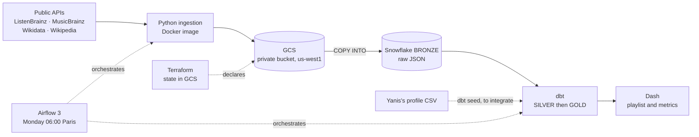

# Vayba · "New vibes" data platform

> *We help you find new vibes.*

Project for the **Data Engineering & Cloud Infrastructure** course (Albert School, M2, 2026), group 7:
Yanis Rajhi, Elimane Diallo, Hugo van Zuylen van Nyevelt.

Vayba is a **fictional** B2C music-streaming company whose main competitor is Spotify. Every Monday it gives each
listener a "New vibes" playlist of **10 artists missing from their listening history**, chosen by **co-listening**:
what listeners with similar tastes play.

The company is fictional, but **the data is real**: real public listens stand in for Vayba's internal logs.
The pipeline runs from the API to the app. It runs in the cloud, can be replayed without double counting, and is tested.

---

## Architecture



| Step | Tool | Why | Alternative not chosen |
|---|---|---|---|
| Ingestion | Python scripts in a container | Simple public APIs, custom filtering | Airbyte or Fivetran: oversized here |
| Landing | Private GCS bucket | Raw files kept and replayable, read natively by Snowflake | — |
| Warehouse | Snowflake, XS warehouse | Compute separate from storage, auto-suspends after 60 s | BigQuery: simpler on GCP, but one more tool to learn |
| Transformation | dbt | Versioned SQL, tests, lineage | — |
| Orchestration | Airflow 3 with DockerOperator | Ingestion runs outside Snowflake | Snowflake tasks: they do not cover ingestion |
| Infrastructure | Terraform | Bucket, access and read role as code, locked state | Console: nothing is reproducible |
| Delivery | Dash | Lightweight, read-only Python app | Streamlit |

**Region:** the Snowflake account is on AWS `us-west-2` (Oregon), so the bucket is on GCP `us-west1`, right next to it.
In production, a French company would choose a European region for both, because of GDPR.

## Sources

| Source | Provides | Ingestion method | Volume loaded |
|---|---|---|---|
| ListenBrainz | Listens per user | API, the week is replaced on every run | 16,447 listens, 25 users, 2 weeks |
| MusicBrainz | Artist identity | Incremental API: only new artists are requested | 2,478 artists |
| Wikidata | Link from an artist to Wikipedia | API, called during the Wikipedia step | 1,278 links |
| Wikipedia pageviews | External popularity | API, the week is replaced on every run | 1,234 documents |
| Yanis's profile | Declared tastes, for a subjective check | CSV file ([docs/team_profile_yanis.csv](docs/team_profile_yanis.csv)) | 23 artists, 14 of them present in the listens |

Spotify data is not used: its terms forbid analysing its content or training on it.

## Repository layout

| Folder | Contents | Owner |
|---|---|---|
| [`ingestion/`](ingestion/README.md) | `run.py` (one command per source and week), bronze SQL, offline tests | Yanis |
| [`dbt/`](dbt/README.md) | Silver and gold models, tests, macros, evidence | Hugo |
| [`dashboard/`](dashboard/README.md) | Read-only Dash app on GOLD | Hugo |
| [`airflow/`](airflow/) | `vayba_weekly` DAG, Airflow image, `docker-compose.yml` | Elimane |
| [`docker/pipeline/`](docker/pipeline/Dockerfile) | `vayba-pipeline:1.0.0` image (ingestion and dbt) | Elimane |
| [`terraform/`](terraform/main.tf) | Bucket, access rights, custom read role for Snowflake | Elimane |
| [`docs/`](docs/) | [Business case](docs/business.md), [runbook](docs/runbook.md), [dated evidence](docs/evidence/) | Everyone |

## Running the pipeline

Full details, with each prerequisite and its owner, are in the [runbook](docs/runbook.md).

**Prerequisites**, done once:
1. A GCP project, a Terraform state bucket, then `terraform apply` in `terraform/`.
2. On Snowflake: the storage integration, the stage and the bronze tables ([`ingestion/sql/setup_bronze.sql`](ingestion/sql/setup_bronze.sql)), then one user and role per member, with RSA key authentication.
3. Copy `.env.example` to `.env`, and `airflow/.env.example` to `airflow/.env`. These files are never committed.
4. Sign in to GCP: `gcloud auth application-default login`.

**Launch**, from the repository root:

```bash
docker build -f docker/pipeline/Dockerfile -t vayba-pipeline:1.0.0 .
```

```bash
cd airflow && docker compose up --build
```

Open http://localhost:8080, unpause `vayba_weekly`, then trigger it with the `week` parameter (a Monday, e.g. `2026-10-26`).
If `week` is empty, the DAG processes the previous week. It also runs on its own every Monday at 06:00, Paris time.

```
ingest_listenbrainz → ingest_musicbrainz → ingest_wikipedia → dbt_build
```

**Without the cloud**, to test dbt locally on DuckDB with fixtures, see [dbt/README.md](dbt/README.md).

## Results (week of October 26, 2026)

| Metric | Value | Meaning |
|---|---|---|
| `HIT_RATE_S1` co-listening | **0.48** (12/25) | Users who played a recommended artist the following week |
| `HIT_RATE_BASELINE_S1` popularity | **0.56** (14/25) | Same measure, with the most popular artists |
| `DISCOVERY_RATE` | 0.38 | Listens of the week where every artist is new to the user |
| `LESSER_KNOWN_RATE` | 0.011 (1/88) | Recommended artists under 1,000 Wikipedia views over 7 days |
| `WIKI_COVERAGE_RATE` | 1.00 | Share of recommended artists with known pageviews |

**For now, popularity wins,** by two users out of 25. The pipeline measures this itself. The main cause: 25 users
and two weeks are too few. The automatic switch to popularity is not implemented.

## Reliability

- **Replay without double counting:** each run replaces its week in a single transaction, and silver deduplicates listens. Replaying the week of October 26 gives the same **16,447 listens, 0 duplicates and 250 playlist rows**.
- **dbt tests:** 13 tests, including a unique key, two business rules (no already-played artist is recommended; every artist exists in MusicBrainz), a completeness test on the week, and shape tests. A failure was demonstrated on Snowflake: the test turns to "fail", then passes again after the data is restored.
- **Late data:** the same week gave 8,001, then 8,003 listens a few hours apart. This is why each run replaces the week instead of freezing it.
- **Real incidents:**
  - **Snowflake key rejected** (`JWT token is invalid`), tested: Airflow retries the task, bronze stays intact, and the retry succeeds once the key is fixed.
  - **Error 412** from the school's Google organization, which rejected Snowflake's service account: fixed with a project outside the organization, using the same Terraform code.
  - **Incomplete week avoided under Airflow 3:** caught in the logs before the DAG was activated.
- **Operations:** 2 Airflow retries 5 minutes apart, an alert on failure, one run at a time.

## Security and costs

- **Least privilege, verified:** allowed and denied access were tested for each case. A reader cannot upload to the bucket. The Dash role only reads GOLD: reading BRONZE and writing to GOLD are denied.
- **Secrets:** Snowflake RSA keys and Google credentials are mounted read-only at run time, never in the image or in Git. No service account key exists.
- **Personal data:** usernames are hashed with SHA-256 from silver onwards. This is pseudonymisation, not anonymisation. Invalid listens go to quarantine, with their reason.
- **Prototype cost, November 1 to 4:** 1.86 Snowflake credits, about $5.59, and €0.00 on GCP. The bucket holds 48 MB. One-year projection: under $300, an upper bound.
- **Safeguards:** a GCP budget alert, a Snowflake monitor of 10 credits per month that suspends the warehouse, and a shutdown procedure in the [runbook](docs/runbook.md).

## Evidence

| Evidence | File |
|---|---|
| Production Airflow run, JWT incident, Snowflake checks | [docs/evidence/2026-11-03_airflow_run.md](docs/evidence/2026-11-03_airflow_run.md) |
| Replay of two weeks and three sources | [docs/evidence/](docs/evidence/) (`*_replay.json`, screenshots) |
| Terraform, error 412, the recreated-bucket pitfall | [docs/evidence/2026-11-02_terraform_gcs.md](docs/evidence/2026-11-02_terraform_gcs.md) |
| Ingestion in Docker, late data | [docs/evidence/2026-11-02_docker_ingestion.md](docs/evidence/2026-11-02_docker_ingestion.md) |
| dbt builds, demonstrated failure, lineage, Snowflake costs | [dbt/evidence/](dbt/evidence/) |
| Denied access, Dash screenshots | [dashboard/evidence/](dashboard/evidence/) |
| GCP costs, budget alert | [docs/evidence/](docs/evidence/) (`*_gcp_*.png`) |

The pipeline video is distributed outside the repository.

## Limits

- **Sample:** 25 users and 2 weeks, too few to beat popularity.
- **Unrepresentative audience:** ListenBrainz users do not reflect all listeners. Their country and subscription are unknown.
- **Offline evaluation:** no real feedback on the recommendations.
- **Region and deployment:** the data is in the United States, and the Dash app runs locally.
- **Business figures:** they are assumptions, detailed in the [business case](docs/business.md).

## Data licences

Only public data is used: MusicBrainz is limited to its CC0 part, and Wikidata is CC0. The licences of ListenBrainz
listens and of Wikipedia pageviews are still to be confirmed on their official pages.
