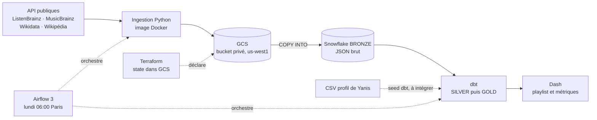

# Vayba · plateforme de données « Nouvelles vibes »

> *On t'aide à chercher de nouvelles vibes.*

Projet du cours **Data Engineering & Infrastructure Cloud** (Albert School, M2, 2026), groupe 7 :
Yanis Rajhi, Elimane Diallo, Hugo van Zuylen van Nyevelt.

Vayba est une entreprise **fictive** de streaming musical, en B2C, dont Spotify est le principal concurrent. Chaque lundi,
elle propose à chaque auditeur une playlist « Nouvelles vibes » de **10 artistes absents de son historique**.
Ces artistes sont choisis par **co-écoute** : ce qu'écoutent les auditeurs aux goûts proches.

L'entreprise est fictive, mais **les données sont réelles** : de vraies écoutes publiques remplacent les logs internes de Vayba.
Le pipeline va de l'API jusqu'à l'application. Il tourne dans le cloud, se rejoue sans double comptage, et il est testé.

---

## Architecture



| Étape | Outil | Pourquoi | Alternative écartée |
|---|---|---|---|
| Ingestion | Scripts Python dans un conteneur | API publiques simples, filtrage sur mesure | Airbyte ou Fivetran : surdimensionnés ici |
| Atterrissage | Bucket GCS privé | Fichiers bruts conservés et rejouables, lus nativement par Snowflake | — |
| Entrepôt | Snowflake, warehouse XS | Calcul séparé du stockage, arrêt automatique après 60 s | BigQuery : plus simple sur GCP, mais un outil de plus à apprendre |
| Transformation | dbt | SQL versionné, tests, lignage | — |
| Orchestration | Airflow 3 et DockerOperator | L'ingestion tourne hors de Snowflake | Tâches Snowflake : ne couvrent pas l'ingestion |
| Infrastructure | Terraform | Bucket, droits et rôle de lecture en code, state verrouillé | Console : rien n'est reproductible |
| Restitution | Dash | Une app Python légère, en lecture seule | Streamlit |

**Région :** le compte Snowflake est en AWS `us-west-2` (Oregon), donc le bucket est en GCP `us-west1`, juste à côté.
En production, une entreprise française choisirait une région européenne pour les deux, à cause du RGPD.

## Sources

| Source | Apport | Méthode d'ingestion | Volume chargé |
|---|---|---|---|
| ListenBrainz | Écoutes par auditeur | API, la semaine est remplacée à chaque run | 16 447 écoutes, 25 auditeurs, 2 semaines |
| MusicBrainz | Identité des artistes | API incrémentale : seuls les nouveaux artistes sont demandés | 2 478 artistes |
| Wikidata | Lien de l'artiste vers Wikipédia | API, appelée pendant l'étape Wikipédia | 1 278 liens |
| Pages vues Wikipédia | Popularité externe | API, la semaine est remplacée à chaque run | 1 234 documents |
| Profil de Yanis | Goûts déclarés, pour un contrôle subjectif | Fichier CSV ([docs/team_profile_yanis.csv](docs/team_profile_yanis.csv)) | 23 artistes, dont 14 présents dans les écoutes |

Les données Spotify ne sont pas utilisées : ses conditions interdisent l'analyse et l'entraînement sur ses contenus.

## Organisation du dépôt

| Dossier | Contenu | Responsable |
|---|---|---|
| [`ingestion/`](ingestion/README.md) | `run.py` (une commande par source et par semaine), SQL de bronze, tests hors ligne | Yanis |
| [`dbt/`](dbt/README.md) | Modèles silver et gold, tests, macros, preuves | Hugo |
| [`dashboard/`](dashboard/README.md) | Application Dash en lecture seule sur GOLD | Hugo |
| [`airflow/`](airflow/) | DAG `vayba_weekly`, image Airflow, `docker-compose.yml` | Elimane |
| [`docker/pipeline/`](docker/pipeline/Dockerfile) | Image `vayba-pipeline:1.0.0` (ingestion et dbt) | Elimane |
| [`terraform/`](terraform/main.tf) | Bucket, droits d'accès, rôle de lecture sur mesure pour Snowflake | Elimane |
| [`docs/`](docs/) | [Dossier métier](docs/business.md), [runbook](docs/runbook.md), [preuves datées](docs/evidence/), [transcript de l'oral](docs/transcript_oral.md) | Tous |

## Lancer le pipeline

Le détail, avec les prérequis et leurs responsables, est dans le [runbook](docs/runbook.md).

**Prérequis**, à faire une seule fois :
1. Un projet GCP, un bucket de state Terraform, puis `terraform apply` dans `terraform/`.
2. Côté Snowflake : la storage integration, le stage et les tables bronze ([`ingestion/sql/setup_bronze.sql`](ingestion/sql/setup_bronze.sql)), puis un utilisateur et un rôle par membre, avec authentification par clé RSA.
3. Copier `.env.example` vers `.env`, et `airflow/.env.example` vers `airflow/.env`. Ces fichiers ne sont jamais commités.
4. Se connecter à GCP : `gcloud auth application-default login`.

**Lancement**, depuis la racine du dépôt :

```bash
docker build -f docker/pipeline/Dockerfile -t vayba-pipeline:1.0.0 .
```

```bash
cd airflow && docker compose up --build
```

Ouvrir http://localhost:8080, activer `vayba_weekly`, puis le déclencher avec le paramètre `week` (un lundi, par exemple `2026-10-26`).
Si `week` est vide, le DAG traite la semaine précédente. Il tourne aussi seul, chaque lundi à 06:00, heure de Paris.

```
ingest_listenbrainz → ingest_musicbrainz → ingest_wikipedia → dbt_build
```

**Sans cloud**, pour tester dbt en local sur DuckDB avec des fixtures, voir [dbt/README.md](dbt/README.md).

## Résultats (semaine du 26 octobre 2026)

| Métrique | Valeur | Lecture |
|---|---|---|
| `HIT_RATE_S1` co-écoute | **0,48** (12/25) | Auditeurs ayant écouté un artiste recommandé la semaine suivante |
| `HIT_RATE_BASELINE_S1` popularité | **0,56** (14/25) | Même mesure, avec les artistes les plus populaires |
| `DISCOVERY_RATE` | 0,38 | Écoutes de la semaine dont tous les artistes sont nouveaux pour l'auditeur |
| `LESSER_KNOWN_RATE` | 0,011 (1/88) | Artistes recommandés sous 1 000 vues Wikipédia en 7 jours |
| `WIKI_COVERAGE_RATE` | 1,00 | Part des artistes recommandés dont on connaît les pages vues |

**Pour l'instant, la popularité gagne,** de deux auditeurs sur 25. Le pipeline le mesure lui-même. La cause principale :
25 auditeurs et deux semaines, c'est trop peu. Le basculement automatique vers la popularité n'est pas implémenté.

## Fiabilité

- **Rejeu sans double comptage :** chaque run remplace sa semaine en une seule transaction, et silver dédoublonne les écoutes. Relancer la semaine du 26 octobre redonne **16 447 écoutes, 0 doublon et 250 lignes de playlist**.
- **Tests dbt :** 13 tests, dont une clé unique, deux règles métier (aucun artiste déjà écouté n'est recommandé ; tout artiste existe dans MusicBrainz), un test de complétude de la semaine et des tests de forme. Un échec a été démontré sur Snowflake : le test passe à « fail », puis repasse après restauration.
- **Données tardives :** la même semaine a donné 8 001, puis 8 003 écoutes à quelques heures d'écart. C'est pour ça qu'on remplace la semaine au lieu de la figer.
- **Incidents réels :**
  - **Clé Snowflake refusée** (`JWT token is invalid`), testé : Airflow passe en retry, le bronze reste intact, puis le retry réussit après correction de la clé.
  - **Erreur 412** de l'organisation Google de l'école, qui refusait le compte de service Snowflake : corrigée avec un projet hors organisation, et le même code Terraform.
  - **Semaine incomplète évitée sous Airflow 3 :** repérée dans les logs avant l'activation du DAG.
- **Exploitation :** 2 retries Airflow espacés de 5 minutes, une alerte en cas d'échec, une exécution à la fois.

## Sécurité et coûts

- **Moindre privilège, vérifié :** l'accès autorisé ou refusé a été testé pour chaque cas. Un lecteur ne peut pas déposer dans le bucket. Le rôle de Dash ne lit que GOLD : la lecture de BRONZE et l'écriture dans GOLD sont refusées.
- **Secrets :** clés RSA Snowflake et identifiants Google montés en lecture seule au moment du run, jamais dans l'image ni dans Git. Aucune clé de compte de service n'existe.
- **Données personnelles :** pseudos hachés en SHA-256 dès silver. C'est une pseudonymisation, pas une anonymisation. Les écoutes invalides partent en quarantaine, avec leur raison.
- **Coût du prototype, du 1er au 4 novembre :** 1,86 crédit Snowflake, soit environ 5,59 $, et 0,00 € sur GCP. Le bucket fait 48 Mo. Projection sur un an : moins de 300 $, une borne haute.
- **Garde-fous :** une alerte budget GCP, un moniteur Snowflake de 10 crédits par mois qui suspend le warehouse, et une procédure d'arrêt dans le [runbook](docs/runbook.md).

## Preuves

| Preuve | Fichier |
|---|---|
| Run Airflow de production, incident JWT, contrôles Snowflake | [docs/evidence/2026-11-03_airflow_run.md](docs/evidence/2026-11-03_airflow_run.md) |
| Rejeu de deux semaines et de trois sources | [docs/evidence/](docs/evidence/) (`*_replay.json`, captures) |
| Terraform, incident 412, piège du bucket recréé | [docs/evidence/2026-11-02_terraform_gcs.md](docs/evidence/2026-11-02_terraform_gcs.md) |
| Ingestion dans Docker, données tardives | [docs/evidence/2026-11-02_docker_ingestion.md](docs/evidence/2026-11-02_docker_ingestion.md) |
| Builds dbt, échec démontré, lignage, coûts Snowflake | [dbt/evidence/](dbt/evidence/) |
| Accès refusés, captures de Dash | [dashboard/evidence/](dashboard/evidence/) |
| Coûts GCP, alerte budget | [docs/evidence/](docs/evidence/) (`*_gcp_*.png`) |

La vidéo du pipeline est distribuée en dehors du dépôt.

## Limites

- **Échantillon :** 25 auditeurs et 2 semaines, trop peu pour battre la popularité.
- **Public non représentatif :** les utilisateurs de ListenBrainz ne reflètent pas tous les auditeurs. On ne connaît ni leur pays ni leur abonnement.
- **Évaluation hors ligne :** aucun vrai retour sur les recommandations.
- **Région et déploiement :** les données sont aux États-Unis, et l'app Dash tourne en local.
- **Chiffres économiques :** ce sont des hypothèses, détaillées dans le [dossier métier](docs/business.md).

## Licences des données

Seules des données publiques sont utilisées : MusicBrainz est limité à sa partie CC0, et Wikidata est en CC0. La licence des écoutes ListenBrainz et celle des pages vues Wikipédia sont à confirmer sur leurs pages officielles.
